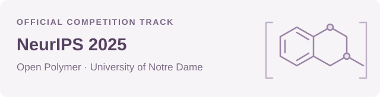

# Hi, I'm Mayin 👋

  
  <picture></picture>
  <picture></picture>

**Nanjing University · M.S. 2027 (expected)**

I work across **LLMs, agents, multimodal learning, and AI for Science**, from model training and inference to evaluation and applications. My experience includes AI algorithm internships at **Huawei** and **Alibaba**.

[Competitions](#competition-repositories) · [Experience](#experience) · [Research](#research) · [Contact](mailto:1196973334@qq.com)

## Competition Repositories

<table>
<tr>
<td width="50%" valign="top">

<h3><picture></picture> <a href="https://github.com/mayin0902/openai-ai-agent-security-silver">AI Agent Security</a></h3>

<strong>🥈 Silver · 58 / 4,186 teams · Top 1.39%</strong>

Co-hosted by <a href="https://www.kaggle.com/competitions/ai-agent-security-multi-step-tool-attacks/rules"><strong>OpenAI, Google and IEEE</strong></a>. An international challenge on reproducible failures in tool-using agents.

Model-specific search, tool-trace feedback, and replayable security evaluation.

<code>GPT-OSS</code> <code>Gemma</code> <code>aicomp_sdk</code>

</td>
<td width="50%" valign="top">

<h3><picture></picture> <a href="https://github.com/mayin0902/google-jigsaw-agile-community-rules-silver">Agile Community Rules</a></h3>

<strong>🥈 Silver · 42 / 2,445 teams · Top 1.72%</strong>

Hosted by <a href="https://www.kaggle.com/competitions/jigsaw-agile-community-rules/rules"><strong>Google Jigsaw / Conversation AI</strong></a>. A Kaggle Featured competition on real-world community moderation.

Rule-conditioned LLM judging, efficient post-training, inference, and model ensembles.

<code>Qwen3</code> <code>QLoRA</code> <code>vLLM</code>

</td>
</tr>
<tr>
<td width="50%" valign="top">

<h3><picture></picture> <a href="https://github.com/mayin0902/csiro-image2biomass-silver">Image2Biomass</a></h3>

<strong>🥈 Silver · 83 / 3,803 teams · Top 2.18%</strong>

Led by <a href="https://www.csiro.au/en/news/All/News/2026/April/New-AI-tools-find-smarter-ways-to-measure-pasture"><strong>CSIRO, Australia's national science agency</strong></a>, with Google Australia and Meat &amp; Livestock Australia.

Dual-view visual features and structured prediction of five pasture biomass targets.

<code>DINOv3</code> <code>SigLIP</code> <code>GBDT</code>

</td>
<td width="50%" valign="top">

<h3><picture></picture> <a href="https://github.com/mayin0902/neurips-open-polymer-prediction-bronze">Open Polymer Prediction</a></h3>

<strong>🥉 Bronze · 217 / 2,240 teams · Top 9.69%</strong>

<a href="https://blog.neurips.cc/2025/06/27/neurips-2025-competitions-announced/"><strong>NeurIPS 2025 official Competition Track</strong></a>. Hosted by the <a href="https://www.kaggle.com/competitions/neurips-open-polymer-prediction-2025/rules">University of Notre Dame</a>.

Molecular representations and complementary models for material property prediction.

<code>RDKit</code> <code>GNN</code> <code>CatBoost</code>

</td>
</tr>
</table>

### <picture></picture> [Jittor Ultrasound Classification](https://github.com/mayin0902/7th-jittor-cainiao-ultrasound-images)

**B leaderboard: 7th · National finalist**

A challenge founded by **Tsinghua University's BNRist and the Tsinghua–Tencent Joint Laboratory**, under the guidance and funding of NSFC's Department of Information Sciences. [Official event background](https://cg.cs.tsinghua.edu.cn/jittor/news/2025-10-14-11-55-00-00-JittorComp5th/)

Fine-grained BI-RADS grading with multi-scale features and ordinal learning.

<strong>Explore competition methods and implementation details</strong>

### [AI Agent Security](https://github.com/mayin0902/openai-ai-agent-security-silver)

**Team Silver Medal · Jun–Sep 2026** · [Official competition](https://www.kaggle.com/competitions/ai-agent-security-multi-step-tool-attacks/overview)

- Contributed to **40 configurations across GPT-OSS and Gemma**, evaluating actual tool execution through traces.
- Configured **30 probes per strategy**, ranking strategies by a heuristic estimate of tool-action reward per second over the final 20 probes.
- Supported up to **2,000 candidates per model** and a single-file SDK submission for independent replay; analyzed public/hidden guardrail differences and removed dependence on a fixed test marker.

### [Google Jigsaw](https://github.com/mayin0902/google-jigsaw-agile-community-rules-silver)

**Silver Medal · Top 1.72%**

- Fine-tuned **Qwen3-4B with 4-bit QLoRA**, completion-only supervision, and single-token scoring for rule-conditioned moderation.
- Combined generative LLM, **GTE + Triplet Loss**, and **DeBERTa-v3** branches through rank blending.
- Used **DeepSpeed ZeRO-2** for efficient training and **vLLM** for batch inference, including generalization to unseen rules.

### [CSIRO Image2Biomass](https://github.com/mayin0902/csiro-image2biomass-silver)

- Used **357 high-resolution images** to predict five biomass targets with a shared **DINOv3 ViT-Huge** backbone and a Gated Local Token Mixer.
- Predicted Green, Dead, and Clover biomass and reconstructed GDM and Total to preserve target relationships.
- Added **SigLIP + LightGBM / CatBoost**, four-fold validation, and late blending; improved weighted **R² from 0.54 to 0.63**.

### [Open Polymer Prediction](https://github.com/mayin0902/neurips-open-polymer-prediction-bronze)

- Combined **RDKit / Mordred descriptors, molecular fingerprints, graph models, and gradient-boosted trees**.
- Addressed missing labels, different target scales, feature selection, and multi-target validation.

### [Jittor Ultrasound Classification](https://github.com/mayin0902/7th-jittor-cainiao-ultrasound-images)

- Combined **EfficientNetV2**, multi-scale features, BN-Neck, and Multi-Dropout for limited and imbalanced data.
- Explored cumulative ordinal labels with BCEWithLogitsLoss; used **five-fold validation, TTA, checkpoint ensembles, and Jittor AMP**.

### <picture></picture> Financial Text-to-SQL

**China Merchants Bank Digital Finance Bootcamp · Jun 2026**  
**Training track: individual 1st place · Team Silver Award**

Built a Qwen3.5-2B training and execution-verification workflow across **4 database schemas and 5,635 interaction turns**. Improved **execution-verified SQL labels from 36.6% to 97.32%**.

Post-training and verification details

- Applied **LoRA, SFT, DPO, and GRPO / RLVR**, using real query execution feedback for supervision and preference construction.
- Corrected **345 timezone-related false errors**; validated **5,484 / 5,635 SQL labels**.
- Built a **PostgreSQL execution verifier** for execution status, result consistency, and error analysis.
- Training framework: Twinkle.

## Experience

### <picture></picture> Huawei · AI Application Algorithm Intern

**Jul 2026–Present · Image Processing Project Lead · Outstanding Intern**

Developed **Retarget-Agent** for content-aware image adaptation, preserving people, products, text, and logos.

Evaluated **600+ business images across 8 routes**. A-grade rates on the fixed evaluation set:

| Best single method | Agent selection | + Generative repair |
| :---: | :---: | :---: |
| **77.33%** | **93.00%** | **96.33%** |

Responsibilities and technical details

- Established a quality rubric covering content fidelity, visual completeness, and composition.
- Combined detection, OCR, segmentation, and geometric processing with multimodal judging to generate, score, and select candidates.
- Added controlled generative repair with original subject/text restoration, re-evaluation, and fallback.
- Delivered **FastAPI interfaces and replay-based evaluation**, including versioned results and failure analysis.

**Stack:** Python · OpenCV · YOLO · OCR · SAM · ComfyUI · FLUX · FastAPI

### <picture></picture> Alibaba Group · Taobao AIGC Algorithm Intern

**Nov 2025–Feb 2026 · Virtual Try-on**

Developed AI-generated product imagery for apparel merchants, focusing on garment detail, identity consistency, and production efficiency.

**500+ real product/model images** · Selected merchant assets: **~7 days of traditional shooting → ~30 minutes**

Responsibilities and technical details

- Built controllable try-on workflows with **FLUX.1 Fill + Redux** and **Gemini image editing**, combining garment references, model images, masks, and prompts.
- Developed preprocessing, automatic captioning, workflow-to-API conversion, batch inference, and configurable **FastAPI** interfaces.
- Fine-tuned and integrated **Face-Fidelity LoRA**, covering data preparation, captioning, inference tuning, and dynamic ComfyUI loading.
- Designed quality-based routing and review for garment texture, faces, and occlusion boundaries, with bounded retries for failed outputs.

**Stack:** Python · FLUX · Gemini · LoRA · SigLIP · ComfyUI · FastAPI

## Research

**First-author work in molecular machine learning and scientific computing.**

| Research | Selected results |
| --- | --- |
| ⚛️ **PRISM · Multi-fidelity Equivariant Neural Potentials** | **200 MP2 configurations** · Energy MAE **0.48 meV/atom** · Force MAE **42.31 meV/Å** |
| 🧪 **Hydrogen Transport at Mineral Interfaces** | **40k+ atomic configurations** · DFT → ML potentials → molecular dynamics |

Research methods and benchmark details

**PRISM**

- Learned medium- and high-fidelity energy/force corrections to a low-cost physical baseline using a shared equivariant graph representation.
- Combined multi-fidelity residual learning, joint energy–force training, data alignment, and controlled ablations.
- On PBC-Water, reduced energy error by **67.3% vs. Δ-EGNN** and force error by **26.4% vs. Δ-PaiNN** in the reported benchmark comparisons.
- **Stack:** PyTorch · SchNetPack · Equivariant GNNs · Linux / HPC.

**Hydrogen transport · Jiangsu Provincial Frontier Technology R&D Project**

- Connected structure sampling, VASP labeling, data quality checks, DeepMD / DPA / MACE training, and LAMMPS simulations.
- Analyzed aggregation and transport in nanoconfined brine and mineral interfaces through density, clustering, diffusion, orientation, and residence-time statistics.

## Toolkit

| | |
| --- | --- |
| **Build & deploy** | Python · C/C++ · Linux · Git · FastAPI · SQLite · PostgreSQL |
| **Train & evaluate** | PyTorch · Jittor · Qwen · LoRA / QLoRA · SFT / DPO / GRPO · DeepSpeed · vLLM |
| **Models & applications** | LangGraph · AgentScope · OpenCV · DINOv3 · SigLIP · FLUX · ComfyUI · LightGBM / CatBoost |
| **Scientific computing** | SchNetPack · RDKit · ASE · VASP · DeepMD · MACE · LAMMPS |

---

  <strong>Nanjing University · M.S. in Physical Chemistry · 2024–2027 (expected)</strong> 
  Kuang Yaming Honors School · AI for Science  
  <a href="mailto:1196973334@qq.com">Email</a> &nbsp;·&nbsp;
  <a href="https://github.com/mayin0902?tab=repositories">All repositories</a>

